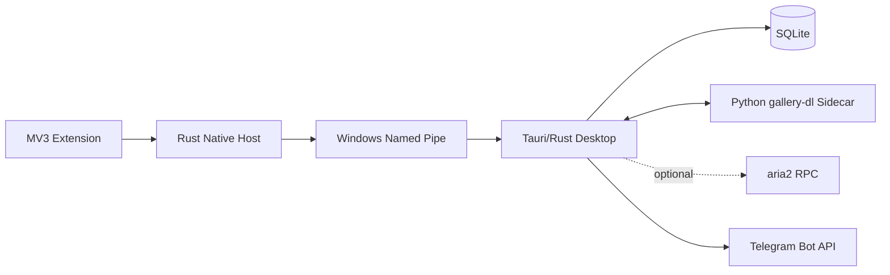

# 总体架构

XArchive 是一个本地优先的 X/Twitter 归档系统。浏览器 Extension 负责发现内容和发起动作，Tauri/Rust Desktop 负责所有业务状态，Python Sidecar 负责适应 X 的提取变化，Telegram 只作为人类友好的展示层。

## 组件边界

- **Extension**：识别 Tweet、提取当前 DOM metadata、注入按钮、批量查询状态；不读 Cookie、不访问文件、不调用 Telegram。当前已实现 classic content script、Tweet DOM adapter、MutationObserver、按钮去重和 Native Messaging Bridge。
- **Native Host**：Native Messaging 与 Named Pipe 的 framing、校验和转发；不保存业务数据。当前已实现 Chromium 长度前缀 framing、消息校验和结构化错误响应，以及 Windows Named Pipe server、ACL 与浏览器安装接线；真实 Windows 注册与浏览器验收仍待执行。
- **Desktop/Rust**：Archive Manager、Job Queue、SQLite、Metadata Merger、FileStore、executor、Sidecar/aria2 Supervisor、Telegram、恢复和 GUI；U8 后不再有旧 `DownloadRouter` fallback 或同步 `archive_tweet` 业务入口。
- **事务与工作流边界（B3–B5 生产接线已实现；当前集成门槛未关闭）**：独立 `xarchive-workflow` crate 定义 attempt identity、协调与 writer 生命周期抽象；Unix `flock` adapter 有真实跨进程锁测试。Desktop `SessionExecutionBoundary` 在 runner operation 中构造 session、持有 Job/destination scopes 并在 guard 下 claim；attempt facts 与 pending publication 为 move-only，生产 InternalV1 路径将相同 Storage/process owners 留在 runner，并尝试在 live session 与 `PublicationOwner` 下最终化。当前集成构建被跨 crate 可见性阻塞：Storage attempt-scoped permit-bearing 方法为 `pub(crate)`，Desktop finalizer 无法调用；Desktop 还存在未调用的旧 V2 helper。修复必须由最窄真实 `PublicationPermit` facade 完成，禁止回退 Job-scoped publisher、公开测试 permit 或启用 production V2。PREPARED/cancel 仲裁、attempt/path/hash 检查和 terminal gap recovery 继续保留；forward publish 的 DB 中途失败、pending panic/Drop 与完整 writer lifecycle/crash 矩阵仍待当前 source 验收。SQLite 数据事实事务与文件移动是分离的可恢复步骤，Telegram 网络发送不属于本地 finalize 事务。目标范围是同主机受支持本地工作区，不承诺跨主机或网络文件系统分布式执行。Windows coordination/no-replace adapter、NTFS 与原生进程/GUI验收由 Windows Owner 负责；缺少该 adapter 不阻止共享 Linux 实现。
- **Python Sidecar**：长驻 JSONL Worker，使用固定版本 gallery-dl 完成 extraction 与（可选的）直接下载；日志写 stderr，stdout 只输出 protocol v2 事件。
- **gallery-dl Adapter**：通过参数数组调用 CLI，使用 metadata/staging 目录归一化 typed extraction result；不让 gallery-dl 内部对象直接进入 Rust 协议。`extract` 命令只提取元数据；`download` 命令在可选下载模式下把媒体字节直接写入命令指定的 staging 目录。
- **媒体结果契约**：Sidecar 报告 typed metadata/media plan；`use_aria2` 关闭时 gallery-dl 直接把媒体写入 staging，Rust 负责最终路径、大小、reparse 和 hash 校验；`use_aria2` 开启时由 aria2 将媒体写入 staging，校验规则相同。
- **aria2**：可选媒体 transfer backend，只负责已提取直链的传输，不能替代 gallery-dl 的 X extractor。默认关闭（`use_aria2 = false`），关闭时 aria2 不启动。
- **aria2 协议层**：`xarchive-download` 已定义 RPC 请求、GID、状态和文件进度模型，并提供跨平台 loopback HTTP JSON-RPC client 与基础 `Aria2Supervisor` 进程监督层；真实 aria2c.exe 生命周期、artifact 分发与传输路由仍属于后续工作。
- **Downloader 参数信任边界（共享 E3 Linux 验收通过；Windows 验收待办）**：Rust 是用户自定义 downloader 参数策略的唯一验证权威；Sidecar 只负责协议结构与 argv 边界，不重复维护用户选项 allowlist。生产任务和批次写入 v3 快照，执行前复验参数策略与所选工具兼容性；Linux 实际 spawn 测试覆盖 aria2 supervisor argv/secret-file 顺序，以及 gallery-dl DownloadRunner 的 argv 边界。gallery-dl allowlist 仍为空，故拒绝其所有用户参数；这不代表用户参数功能已对 gallery-dl 启用。Windows Named Pipe、原生子进程及打包 artifact 验收仍未执行，见下载输出 Plan 和 Windows Validation Queue。
- **Sidecar v2 task arguments（结构与传递已实现；gallery-dl 用户参数仍关闭）**：`download` 可选携带 `user_args: string[]`，Rust 命令模型和 Python worker 做结构/长度验证，Python 仅在该次 gallery-dl download 的 argv 中逐项传递。共享 Linux 测试经 `DownloadRunner` 实际 spawn 验证 argv 边界；生产设置仍因空 allowlist 拒绝 gallery-dl 用户参数，且不得把参数传递接线表述为该功能已启用。
- **Telegram contract/transport**：`xarchive-telegram` 提供 SecretStore abstraction、Bot API request models、metadata formatter、UTF-8 continuation、media group 分组和基于 `reqwest` + Rustls 的 HTTPS transport；发送持久化与恢复、sender worker、命令和 UI 已在 Desktop 接线。Windows Credential Manager adapter 与真实账号发送仍属 Windows 工作。
- **Reliability/TagEngine**：`xarchive-core` 提供错误类别、retry/backoff policy、Windows-safe 用户目录名和确定性的 TagEngine 规则匹配。
- **IDM**：不进入核心架构，最多作为未来个人环境中的实验性外部提交功能。

## 关键不变量

1. Rust/主 SQLite 是唯一业务事实来源。
2. Sidecar/aria2 只产生执行事件，不能自行决定归档最终成功。
3. 当前下载使用 Job staging；C1 目标改为 attempt 隔离的 staging，由 Rust 校验并经可恢复工作流提交最终目录。不同进程可并发处理不同 Job；同 Job 和最终目的地竞争须由经过同进程与跨进程验证的协调及 no-replace 文件操作保护。现有 helper 与跨进程测试不构成生产保证；该目标尚未实现。
4. Extension 与 Desktop 只传 metadata、命令和状态，不传媒体二进制或 Cookie。
5. 同一 Tweet ID 的活动归档任务必须幂等。